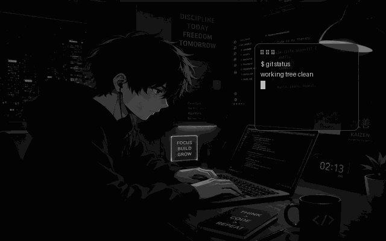

<div align="center">

<a href="https://github.com/soham-newjourney2">
  
</a>


<br/>

<p align="center">
  
</p>

</div>

<p align="center">
  
</p>

<br/>

<table width="100%">
<tr>
<td width="55%" valign="top">

**● ● ●&nbsp;&nbsp;`~/soham/about.sh`**

```
> whoami
Soham Chowdhury — B.Tech CSE @ IEM '29

> cat manifesto.txt
I like building things. But more
importantly, I like understanding
WHY they work. I build from
scratch first, library second.

> location
Kolkata, West Bengal, India
```

</td>
<td width="45%" valign="top">

**● ● ●&nbsp;&nbsp;`~/soham/status.log`**

```
role      : MERN Stack Dev
focus     : AI / ML Explorer
grinding  : DSA daily
award     : Healix 1st · Hack2Heal 3rd
mode      : build > break > improve
uptime    : still enjoying the journey
```

</td>
</tr>
</table>

<br/>

<div align="center">

`[ 01 // STACK ]`

</div>

<table width="100%">
<tr>
<td align="center" width="25%">

**LANGUAGES**


</td>
<td align="center" width="25%">

**WEB**


</td>
<td align="center" width="25%">

**AI / ML**


</td>
<td align="center" width="25%">

**TOOLS**


</td>
</tr>
</table>

<br/>

<div align="center">

`[ 02 // LAB NOTEBOOK ]`
<br/>
<sub>a log of things rebuilt from scratch just to see what the library was hiding</sub>

</div>
<br/>

<table width="100%">
<tr>
<td width="50%" valign="top">

**● ● ●&nbsp;&nbsp;`entry_001.log`**

```
topic   : Linear Regression
built   : Gradient Descent + OLS,
          raw NumPy
versus  : scikit-learn
data    : Medical Cost dataset
note    : sklearn is fast — now
          I know exactly why.
```
[→ view repo](https://github.com/soham-newjourney2/linear-regression-scratch-vs-sklearn)

</td>
<td width="50%" valign="top">

**● ● ●&nbsp;&nbsp;`entry_002.log`**

```
topic   : Logistic Regression
built   : vectorized gradient
          descent, no autograd
versus  : scikit-learn
data    : Titanic
note    : decision boundaries
          finally click once
          you derive them.
```
[→ view repo](https://github.com/soham-newjourney2/logistic-regression-scratch-vs-sklearn)

</td>
</tr>
<tr>
<td width="50%" valign="top">

**● ● ●&nbsp;&nbsp;`entry_003.log`**

```
topic   : k-Nearest Neighbours
built   : custom kNN +
          GridSearchCV pipeline
data    : Cleveland Heart Disease
note    : distance metrics matter
          more than advertised.
```
[→ view repo](https://github.com/soham-newjourney2/heart-disease-knn-scratch-vs-sklearn)

</td>
<td width="50%" valign="top">

**● ● ●&nbsp;&nbsp;`entry_004.log`**

```
topic   : Model Bake-off
tested  : LogReg vs kNN vs
          Naive Bayes, full EDA
data    : Iris
result  : 96% accuracy, zero
          data leakage (checked
          twice).
```
[→ view repo](https://github.com/soham-newjourney2/iris-flower-model-comparison)

</td>
</tr>
</table>

<br/>

<div align="center">

`[ 03 // TROPHY CASE ]`
<br/>
<sub>projects that came home with something</sub>

</div>
<br/>

<details open>
<summary><b>▸ team wins</b></summary>
<br/>

<table width="100%">
<tr>
<td width="50%" valign="top">

**● ● ●&nbsp;&nbsp;`win_001.log`**

```
project : RE:VIVE
result  : 🏆 1st place, Healix
event   : HEALS'26 · IEM
pitch   : one shared recovery record
          for patients, doctors
          and guardians
my role : Team Lead · Backend & AI
stack   : FastAPI · MongoDB ·
          XGBoost + SHAP · vanilla JS
crew    : 4 devs
note    : turned "she'll mention it
          at the next visit" into an
          alert the same night.
```
[→ view repo](https://github.com/soham-newjourney2/Re-Vive)
<br/>
<sub>with [@Saswata427](https://github.com/Saswata427) · [@srijoyeemisra](https://github.com/srijoyeemisra) · [@blacksayan6](https://github.com/blacksayan6)</sub>

</td>

</td>

<td width="50%" valign="top">

**● ● ●&nbsp;&nbsp;`win_002.log`**

```
project : HelpSphere
result  : 🏆 3rd place, Innovare
event   : Innovatia'26 · IEM
pitch   : surplus food and essentials,
          routed to people in need
          through verified NGOs
my role : Team Lead · Frontend
stack   : PHP · MySQL · SMTP ·
          vanilla JS
crew    : 4 devs
note    : turned "40 plates left
          after the event" into an
          alert for the 5 nearest NGOs.
```
[→ view repo](https://github.com/soham-newjourney2/HelpSphere)
<br/>
<sub>with [@Arkoprabho-Roy](https://github.com/Arkoprabho-Roy) · [@srijoyeemisra](https://github.com/srijoyeemisra) · [@blacksayan6](https://github.com/blacksayan6)</sub>

</td>

</tr>
</table>

</details>

<!--
<details>
<summary><b>▸ solo wins</b></summary>
<br/>

**● ● ●&nbsp;&nbsp;`solo_001.log`**

```
status  : nothing logged yet
plan    : working on it
```

</details>
-->

<br/>


<div align="center">

`[ 04 // TEAM BUILDS ]`
<br/>
<sub>things we shipped together: more hands, more bugs, better software</sub>

</div>
<br/>

<table width="100%">
<tr>
<td width="50%" valign="top">

**● ● ●&nbsp;&nbsp;`team_001.log`**

```
project : DataOrigin
pitch   : provenance + reproducibility
          for research datasets & ML
my role : Team Lead · Backend & AI
stack   : FastAPI · scikit-learn ·
          Solidity · vanilla JS
crew    : 4 devs
note    : turned "who changed the
          dataset?" into a SHA-256
          receipt on a blockchain.
```
[→ view repo](https://github.com/soham-newjourney2/DataOrigin)
<br/>
<sub>with [@Saswata427](https://github.com/Saswata427) · [@srijoyeemisra](https://github.com/srijoyeemisra) · [@blacksayan6](https://github.com/blacksayan6)</sub>

</td>

<td width="50%" valign="top">

**● ● ●&nbsp;&nbsp;`team_002.log`**

```
project : JeevCare
pitch   : animal rescue, from one
          photo to the nearest NGO
my role : Backend
stack   : Express · MongoDB ·
          Socket.IO · vanilla JS
crew    : 2 devs
note    : turned "who do I call?"
          into a geo-routed case
          with live updates.
```
[→ view repo](https://github.com/soham-newjourney2/JeevCare)
<br/>
<sub>with [@srijoyeemisra](https://github.com/srijoyeemisra)</sub>

</td>

<td width="50%" valign="top">

**● ● ●&nbsp;&nbsp;`team_003.log`**

```
project : DepGuard AI
pitch   : dependency security that
          shows which CVEs matter
my role : Team Lead · AI & Backend
stack   : FastAPI · OSV · KEV/EPSS ·
          vanilla JS · Playwright
crew    : 3 devs
note    : turned "47 vulnerabilities"
          into a ranked list with a
          path, evidence and a fix.
```
[→ view repo](https://github.com/soham-newjourney2/DepGuard-AI)
<br/>
<sub>with [@Arkoprabho-Roy](https://github.com/Arkoprabho-Roy) · [@Saswata427](https://github.com/Saswata427)</sub>

</td>


</tr>
</table>

<br/>

<div align="center">
  
`[ 05 // MINI-GAME ]`
<br/>
<sub>my contribution graph, playing itself</sub>
 
<br/><br/>
 
<picture>
  <source
    media="(prefers-color-scheme: dark)"
    srcset="https://raw.githubusercontent.com/soham-newjourney2/soham-newjourney2/output/github-contribution-grid-snake-dark.svg"
  />
  <source
    media="(prefers-color-scheme: light)"
    srcset="https://raw.githubusercontent.com/soham-newjourney2/soham-newjourney2/output/github-contribution-grid-snake.svg"
  />
  
</picture>
 
</div>

<br/>

<div align="center">

`[ 06 // METRICS ]`

</div>
<br/>

<div align="center">


</div>

<br/>

<div align="center">

`[ 07 // CONNECT ]`
<br/><br/>

[](https://www.linkedin.com/in/soham-chowdhury-2k25/)
[](https://leetcode.com/u/0eL09kaqgB/)
[](https://github.com/soham-newjourney2)

<br/><br/>


</div>
